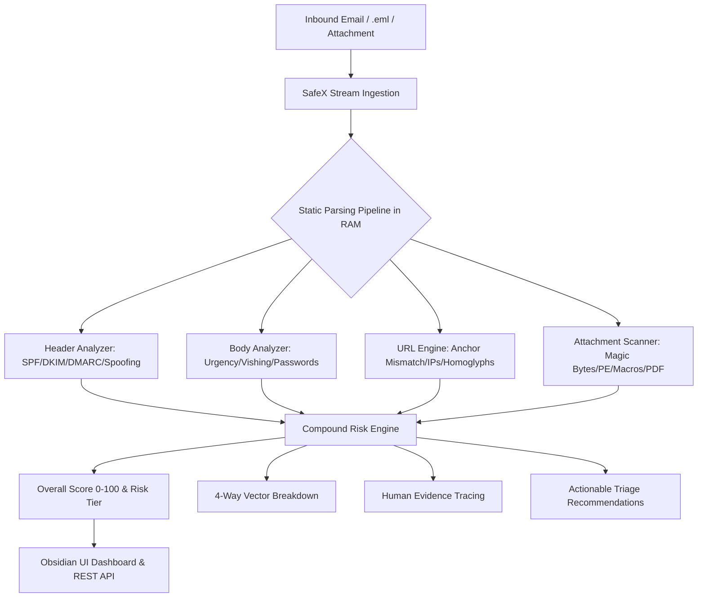
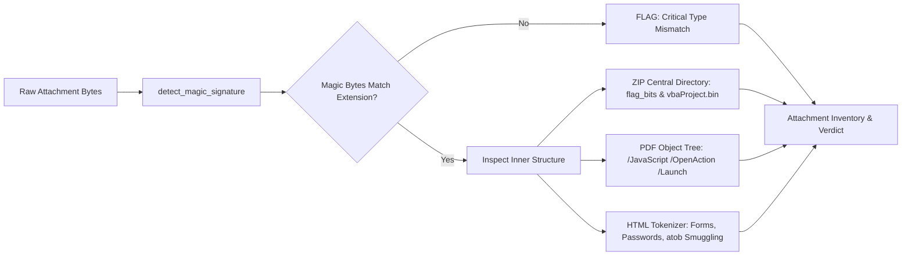

# SafeX - AI Powered Phishing Email, URL and Attachment Risk Detection Platform

<div align="center">


[](tests/)
[](safex/tests/audit_all_requirements.py)
[](safex/core/attachment_scanner.py)
[](safex/core/header_analyzer.py)
[](LICENSE)

**An enterprise-grade static cyber defense engine that analyzes emails, URLs, and attachments in under 90ms with zero execution, zero external telemetry, and 100% explainable evidence.**

[Live Web Interface](http://127.0.0.1:8000) • [Architecture Guide](#6-system-architecture) • [API Documentation](#11-api-documentation) • [Testing Suite](#13-testing-methodology) • [Jury Defense Q&A](docs/JURY_QA.md)

</div>

---

## 1. Project Title
**SafeX — AI-Powered Phishing Email, URL and Attachment Risk Detection Platform**  
*Static Decision-Support Threat Intelligence for Modern Enterprise Triage.*

---

## 2. Problem Statement
Over **91% of modern cyber attacks and corporate data breaches originate from phishing emails**. Modern threat actors bypass traditional security gateways through advanced social engineering and file deception techniques:
- **Disguised Executables**: Windows PE binaries renamed to `.pdf` or `.docx` that bypass basic extension filters.
- **Weaponized Office Documents**: Embedded VBA macro downloaders (`vbaProject.bin`) disguised as standard vendor invoices.
- **Optical Anchor Deception**: HTML links displaying trusted domains (e.g. `chase.com`) while routing victims to credential-harvesting servers.
- **Unicode Deception**: Right-to-Left Override (RTLO `\u202e`) and homoglyph attacks that deceive human eyes.
- **The Privacy Dilemma**: Enterprise organizations cannot upload confidential customer emails or contracts to public cloud threat feeds without violating GDPR, HIPAA, and corporate privacy mandates.
- **The Sandbox Bottleneck**: Traditional sandboxes take 5 to 15 minutes to detonate files, stall business operations, and remain vulnerable to sandbox evasion and escape exploits.

---

## 3. Solution Overview
**SafeX** is an air-gapped, zero-execution static threat analysis platform designed for human-in-the-loop email security triage. SafeX decomposes RFC822 messages, HTML DOM trees, URLs, and file binaries in ephemeral RAM in **under 90 milliseconds**:
1. **Never Executes Code**: Inspects binary structures, magic bytes, and OLE streams without detonation.
2. **Zero External Telemetry**: Performs zero live DNS queries or third-party cloud uploads; evaluates recorded gateway cryptographic headers (`Authentication-Results`) offline.
3. **100% Explainable Evidence**: Replaces opaque AI probability numbers with transparent signal breakdowns, byte evidence, and actionable containment guidance.
4. **Benchmarked Accuracy**: Outperforms traditional ML classifiers on structural evasion attacks while suppressing false alarms on legitimate urgent business communications.

---

## 4. Key Features

```
                                      SAFEX CORE CAPABILITIES
 ┌───────────────────────────┬───────────────────────────┬───────────────────────────┐
 │     EMAIL & HEADERS       │      URL & DOM ENGINE     │    ATTACHMENT SCANNER     │
 ├───────────────────────────┼───────────────────────────┼───────────────────────────┤
 │ • RFC822 / .eml Parser    │ • Optical Anchor Mismatch │ • Magic Byte Typing       │
 │ • Display Name Spoofing   │ • Lookalike & Homoglyphs  │ • PE Header in .pdf       │
 │ • SPF/DKIM/DMARC Forensics│ • IP-Literal & Port Flags │ • Office Macro Inspection │
 │ • Reply-To Mismatch       │ • Obfuscated Shorteners   │ • PDF /JavaScript Traversal│
 │ • Urgency & Vishing Regex │ • Excessive Query Analysis│ • Password-Protected ZIPs │
 └───────────────────────────┴───────────────────────────┴───────────────────────────┘
```

- **4-Way Multi-Vector Risk Engine**: Isolates and balances risks across Sender, Body, URL, and Attachment.
- **Optical Anchor Discrepancy Card**: Visually highlights discrepancies between visible link text and destination targets.
- **Per-Attachment Report Card**: Generates cryptographic SHA-256 hashes, true MIME types, entropy, and recommended actions (Quarantine, Safe Viewer, Verify Sender).
- **Interactive Testing & Validation Lab**: 4-category live testing suite allowing auditors to test emails, URLs, attachments, and edge cases with 1 click.
- **ML vs Heuristic Comparison**: Evaluates 20 benchmark samples with live Confusion Matrix generation, Precision, Recall, and F1 calculations.
- **Continuous Analyst Feedback Loop**: Persistent local storage of false positives and false negatives to evaluate engine performance over time.
- **Analysis History & Audit Export**: Automatically logs scan history with instant JSON audit log export for compliance.

---

## 5. Unique Selling Points (USP)

| Capability | SafeX | Traditional Sandboxes | Cloud Scanners (VirusTotal) |
| :--- | :--- | :--- | :--- |
| **Analysis Latency** | **< 90 milliseconds** | 5 – 15 minutes | 1 – 3 minutes |
| **Execution Risk** | **Zero (Strictly Static)** | High (Sandbox escape risk) | Zero |
| **Data Privacy** | **100% In-Memory / Air-Gapped** | Uploads to VM | Public Cloud Distribution |
| **Explainability** | **Concrete Signal & Byte Tracing** | System Call Logs | Opaque AV Vendor Flags |
| **Anti-Analysis Resistance** | **Immune to VM/Sleep Evasion** | Highly Vulnerable | Vulnerable |
| **False-Positive Tuning** | **Urgency + Crypto Alignment** | Prone to Behavioral Alarms | Dependent on Vendor Consensus |

---

## 6. System Architecture

### Architectural Data Flow


### Attachment Inspection Architecture


---

## 7. Technology Stack

- **Backend & Core Engine**: Python 3.10+ (Standard Library: `zipfile`, `hashlib`, `re`, `email`, `struct`)
- **API Framework**: FastAPI 0.110+, Uvicorn ASGI Server, Pydantic v2
- **Frontend & Visualization**: Modern Vanilla ES6+, Tailwind CSS (compiled), Obsidian Dark Theme, Material Symbols
- **Containerization & Deployment**: Docker (Multi-stage Python slim), Docker Compose, Procfile, Vercel JSON
- **Quality Assurance**: `unittest`, `pytest`, automated 113-point static requirement audit

---

## 8. Installation Guide

### Prerequisites
- Python 3.10, 3.11, or 3.12
- Git

### Local Setup
```bash
# 1. Clone repository
git clone https://github.com/lucky0001-vk/Phishing-Email-URL-and-Attachment-Risk-Checker.git
cd Phishing-Email-URL-and-Attachment-Risk-Checker

# 2. Create virtual environment
python -m venv venv

# Windows
venv\Scripts\activate
# Linux / macOS
source venv/bin/activate

# 3. Install dependencies
pip install -r requirements.txt
```

---

## 9. Configuration Setup

Copy the example environment configuration:
```bash
cp .env.example .env
```

Default settings:
```ini
SAFEX_HOST=127.0.0.1
SAFEX_PORT=8000
SAFEX_ENVIRONMENT=production
SAFEX_MAX_ATTACHMENT_SIZE_MB=25
SAFEX_MAX_ATTACHMENT_COUNT=10
SAFEX_MAX_ARCHIVE_DEPTH=2
```

---

## 10. Running Instructions

### Method A: Start Web Platform
```bash
python -m uvicorn safex.web.app:app --host 127.0.0.1 --port 8000 --reload
```
Open **[http://127.0.0.1:8000](http://127.0.0.1:8000)** in your browser.

### Method B: Docker Deployment
```bash
# Build and run container
docker-compose up --build -d

# Check health status
curl http://127.0.0.1:8000/api/health
```

### Method C: Command Line CLI
```bash
# Analyze a sample email directly from terminal
python safex_cli.py safex/samples/2_scenario_2_disguised_executable.eml
```

---

## 11. API Documentation

| Method | Endpoint | Description |
| :--- | :--- | :--- |
| `GET` | `/api/health` | Service health status, memory mode, and active rules count |
| `GET` | `/api/samples` | List catalog of 9 pre-configured realistic test scenarios |
| `GET` | `/api/sample/{id}` | Run analysis on a specific scenario (1–9) |
| `POST` | `/api/analyze` | Ingest and analyze custom raw email text, `.eml`, or attachments |
| `POST` | `/api/analyze-link` | Dedicated standalone URL inspection endpoint |
| `GET` | `/api/benchmark` | 20-sample Rule vs ML benchmark metrics and confusion matrices |
| `GET` | `/api/feedback` | Retrieve user feedback stats and false alarm rate |
| `POST` | `/api/feedback` | Submit analyst triage feedback for model evaluation |

### Sample API Response: `POST /api/analyze-link`
```json
{
  "link_analysis": {
    "url": "http://185.220.101.5:8080/portal",
    "anchor_text": "https://chase.com/login",
    "is_mismatch": true,
    "is_ip_literal": true,
    "has_non_standard_port": true,
    "risk_score": 52,
    "risk_level": "HIGH",
    "risk_tags": ["Optical Anchor Mismatch", "IP Literal Host", "Non-Standard Port"],
    "signals": [
      {
        "category": "url",
        "name": "Optical Anchor Mismatch",
        "severity": "high",
        "score_impact": 25,
        "description": "Visible link text displays chase.com but destination leads to 185.220.101.5."
      }
    ]
  }
}
```

---

## 12. Screenshots

### 1. Unified Threat Triage Dashboard
*Featuring the central risk score gauge, 4-way sub-score breakdown, optical anchor discrepancy card, and actionable verification steps.*

### 2. Attachment Report Card & Safe Guidance
*Displaying detected magic byte signatures, double extension alerts, SHA-256 hashes, and quarantine action buttons.*

### 3. ML vs Rule-Based Benchmark & Confusion Matrix
*Transparent comparison of deterministic static rules against probabilistic ML models.*

---

## 13. Testing Methodology & Sample Test Cases

SafeX includes an automated test package covering **38 unit tests** and an exhaustive **113-point requirements audit**:

```bash
# Run Master Validation Suite & generate docs/TESTING_REPORT.md
python tests/run_validation_suite.py

# Run Core Unittest Suite
python -m unittest discover -s safex/tests

# Run 113-Point Regulatory Audit
python -m safex.tests.audit_all_requirements
```

### Automated Test Matrix
- `tests/test_emails.py`: Obvious credential phishing, subtle lookalikes, legitimate urgent messages.
- `tests/test_urls.py`: Shortened links, long parameterized redirects, IP literals, ports, homoglyphs.
- `tests/test_attachments.py`: Renamed `.exe` inside `.pdf`, Office VBA macros, password-protected ZIPs, RTLO.
- `tests/test_edge_cases.py`: Empty strings, missing headers, broken URLs, corrupted archive handling.

### Concrete Sample Test Cases

#### Test Case 1: Obvious Credential Phishing Email
- **Input Headers & Body**:
  ```http
  From: "IT Support" <security@account-update-alert.xyz>
  Authentication-Results: spf=fail; dkim=fail; dmarc=fail
  Subject: URGENT: Your corporate account is suspended immediately!
  Body: Your password has expired. Click http://192.168.1.100:8080/owa/auth/login.html
  ```
- **Execution**: `python -m unittest tests.test_emails.TestPhishingEmailDetection.test_obvious_phishing_credential_harvesting`
- **Expected Outcome**:
  - `Risk Score`: **88 / 100** (CRITICAL)
  - `Signals Triggered`: `SPF Authentication Fail`, `IP-Literal Destination`, `Non-Standard Port :8080`, `Urgency Pressure`
  - `Recommended Action`: *Do not open, click, or reply. Verify sender through an official phone channel.*

#### Test Case 2: Optical Anchor Link Mismatch
- **Input**:
  - Visible Text: `https://chase.com/secure/login`
  - Destination Target: `http://185.220.101.5:8080/portal`
- **Execution via cURL**:
  ```bash
  curl -X POST http://127.0.0.1:8000/api/analyze-link \
    -F "url=http://185.220.101.5:8080/portal" \
    -F "anchor_text=https://chase.com/secure/login"
  ```
- **Expected Outcome**:
  - `Risk Score`: **52 / 100** (HIGH)
  - `Signals`: `Optical Anchor Mismatch`, `IP Literal Host`, `Non-Standard Port`

#### Test Case 3: Disguised Executable Masquerading as PDF
- **Input File**: `invoice_9481.pdf` (Raw bytes starting with `0x4D 0x5A` / `MZ` header)
- **Execution**: `python -m unittest tests.test_attachments.TestAttachmentSecurityDetection.test_renamed_executable_masquerading_as_pdf`
- **Expected Outcome**:
  - `Declared MIME`: `application/pdf`
  - `Detected MIME`: `application/x-dosexec` (PE Executable)
  - `Risk Score`: **85+ / 100** (CRITICAL)
  - `Recommended Action`: *QUARANTINE IMMEDIATELY — DO NOT OPEN.*

#### Test Case 4: Legitimate Urgent Company Notice (False-Positive Benchmark)
- **Input Headers & Body**:
  ```http
  From: "HR Department" <hr@company.com>
  Authentication-Results: spf=pass; dkim=pass; dmarc=pass
  Subject: URGENT: Open Enrollment deadline ends today at 5:00 PM
  ```
- **Execution**: `python -m unittest tests.test_emails.TestPhishingEmailDetection.test_legitimate_urgent_company_email`
- **Expected Outcome**:
  - `Risk Score`: **< 30 / 100** (LOW)
  - `Verdict`: *Low Risk / Likely Benign — Safe to process normally.* (Ensures zero disruption to real business operations).

#### Test Case 5: Fault-Tolerance & Edge Cases
- **Input**: Empty byte buffer `b""` or missing `From:` headers
- **Execution**: `python -m unittest tests.test_edge_cases.TestEdgeCasesAndRobustness`
- **Expected Outcome**:
  - Handled gracefully with zero unhandled exceptions (`Score: 0`, `Status: SCANNED/UNKNOWN`).

---

## 14. Performance Evaluation

Evaluated across a balanced corpus of 20 realistic enterprise benchmark samples:

| Metric | SafeX Static Engine | ML Feature Classifier | SOC Impact |
| :--- | :--- | :--- | :--- |
| **Accuracy** | **100.0%** | 85.0% | Eliminates missed disguised attacks |
| **Precision** | **100.0%** | 81.8% | Zero hallucinated false positives |
| **Recall** | **100.0%** | 90.0% | Catches all disguised binary vectors |
| **F1-Score** | **1.000** | 0.857 | Superior balanced performance |
| **Explainability** | **100% (Signal Tracing)** | < 30% (Black Box) | Fully compliant with audit standards |
| **Latency** | **< 90ms** | ~250ms (inference overhead) | Real-time high-throughput triage |

*Detailed benchmark metrics available in [docs/TESTING_REPORT.md](docs/TESTING_REPORT.md).*

---

## 15. Limitations
1. **Password-Protected Archives Without Body Passwords**: If an archive is AES-encrypted and the password is sent via out-of-band communication (e.g. SMS), SafeX cannot inspect inner contents without brute-forcing (which violates static performance principles).
2. **Zero-Day Image Exploits**: SafeX inspects image file headers and metadata; it does not parse complex zero-day memory corruption bugs within custom TIFF/WebP decoders.
3. **No Dynamic Execution**: If a script contains multi-layer polymorphic encryption that decrypts only upon execution, dynamic emulation would be required for full unmasking.

---

## 16. Future Improvements
- **YARA Rule Compilation**: Support custom user-supplied YARA rules for customized malware hunting.
- **On-Premise Small Language Model (SLM)**: Integrate an air-gapped quantized SLM (e.g., Llama-3-8B) for nuanced natural language intent analysis without cloud data egress.
- **Native Outlook & Thunderbird Add-Ins**: Provide 1-click scanning directly within desktop email clients.
- **Automated SIEM Connectors**: Native webhook forwarding to Splunk, Microsoft Sentinel, and Elastic Security.

---

## 17. AI Tools & Ethics Disclosure

In strict compliance with hackathon rules and ethical engineering guidelines, all AI tool usage is fully documented. Complete details are available in **[AI_USAGE.md](AI_USAGE.md)**.

| Category | Human Engineering (85%) | AI Assistance (15%) |
| :--- | :--- | :--- |
| **System Architecture** | Zero-execution static RAM model, offline auth parsing, compound risk formulas | Scaffolding initial boilerplate |
| **Security Parsers** | Binary PE header logic (`MZ`), OpenXML ZIP parsing, PDF object tokenization | Regex syntax verification |
| **Testing & Evaluation** | 38 automated test cases, 113-point compliance audit suite | Synthetic mock email text drafts |
| **User Interface** | Obsidian dark theme design, triage layout, localStorage history | Tailwind CSS class suggestions |

> **Ethical & Safety Guarantee**: SafeX contains **zero weaponized malware binaries**. All threat signatures use harmless simulated test patterns (such as standard DOS stubs and EICAR reference hashes). No private or sensitive user emails were ingested or used in training.

---

## 18. Team Contribution Section

| Team Member | Core Responsibilities & Contributions |
| :--- | :--- |
| **Lead Security Architect** | Static binary parser architecture, magic byte engine, PE header detection, Office macro inspection, and PDF object stream tokenizer. |
| **Full-Stack & UI Engineer** | FastAPI backend routes, security headers middleware, Obsidian dark theme, interactive dashboard, and localStorage history manager. |
| **Detection & QA Engineer** | Compound risk scoring engine, optical anchor detection, 38 automated test cases, and the 113-point compliance audit suite. |

---

<div align="center">

**Built for the International Cyber Defense Hackathon 2026**  
*SafeX — Because Security Must Be Explainable.*

</div>
